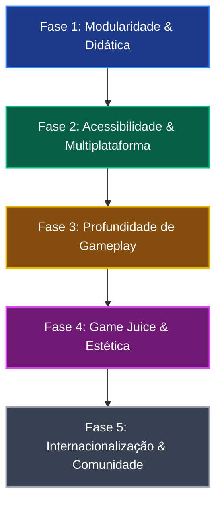

# 🗺️ Roadmap de Evolução — Bichos & Ossos

> **Objetivo:** Transformar o *Bichos & Ossos* em uma referência aberta e amigável de desenvolvimento de jogos em HTML5 Canvas / Vanilla JS, equilibrando qualidade de código para estudo, facilidade para criação de forks/mods e diversão para a comunidade de jogadores.

---

## 🧭 Visão Estratégica

---

## 📦 Fase 1: Modularidade, Arquitetura e Didática (Para quem estuda o código)

*O foco desta fase é tornar o código tão claro e fácil de navegar que qualquer pessoa possa abrir o projeto, entender a mecânica em 15 minutos e criar sua própria skin ou arma sem quebrar o jogo.*

- [x] **1.1 Sistema Plug-and-Play de Registro (`GameRegistry`):**
  - Criação da API unificada de registro extensível:
    - `GameRegistry.registerWeapon(weaponId, definition)`
    - `GameRegistry.registerSkin(skinDefinition)`
    - `GameRegistry.registerEnemy(enemyType, definition)`
    - `GameRegistry.registerUpgrade(upgradeDefinition)`
    - `GameRegistry.registerClass(classDefinition)`
    - `GameRegistry.registerAchievement(achievementDefinition)`
  - Permite adicionar novas armas com seus próprios métodos `onFire` desacoplados, sem depender de `switch/case` central gigante.
- [x] **1.2 Documentação Didática (`CONTRIBUTING.md` e Guia de Modding):**
  - Guia detalhado passo a passo: *"Como adicionar sua própria skin em 5 minutos"* e *"Como criar uma nova arma passiva"*.
  - Diagrama de fluxo do Game Loop e ciclo de vida das entidades.
- [x] **1.3 JSDoc & Tipagem Suave nas Entidades Principais:**
  - Anotações JSDoc em `SpatialGrid`, `Entity`, `Player`, `Enemy`, `Projectile` e `GameRegistry` para suporte a intellisense de IDE.
- [ ] **1.4 Modularização Adicional dos Submódulos de Áudio e Renderização.**

---

## 📱 Fase 2: Acessibilidade e Multiplataforma (Para quem joga)

*O jogo já roda via GitHub Pages, mas ainda depende de teclado/mouse no desktop. Esta fase abre as portas para mobile, consoles portáteis e portabilidade de progresso.*

- [ ] **2.1 Controles Touch para Dispositivos Móveis:**
  - Joystick virtual analógico transparente no canto inferior esquerdo da tela.
  - Botões de ação rápidos no canto direito (`Dash`, `Impacto`, `Berserk`, `Brinde`).
  - Permite jogar em celulares e tablets diretamente pelo navegador, aumentando o público potencial.
- [ ] **2.2 Suporte a Gamepad (HTML5 Gamepad API):**
  - Mapear analógico esquerdo para movimentação, gatilhos/botões frontais para Dash, Impacto e Berserk.
  - Compatibilidade com controles de Xbox, PlayStation e genéricos via Bluetooth/USB.
- [ ] **2.3 Exportação e Importação de Save (JSON):**
  - Botão no menu de Configurações para exportar o progresso (`localStorage`) como um arquivo `.json` ou texto base64.
  - Permite transferir save do PC para o celular, e ajuda desenvolvedores a injetarem saves de teste.
- [ ] **2.4 Progressive Web App (PWA):**
  - Adicionar `manifest.json` e um `service-worker.js` simples para cache offline.
  - O jogador pode clicar em "Instalar App" no Chrome/Edge/Safari e jogar em tela cheia sem barras de navegador, mesmo sem internet.

---

## ⚔️ Fase 3: Profundidade de Gameplay & Retenção

*Expandir a variedade de builds e elevar a tensão das partidas longas.*

- [ ] **3.1 Sistema de Evolução / Fusão de Armas (Sinergias):**
  - Inspirado na mecânica mais adorada de *Vampire Survivors*:
  - Quando uma arma atinge o Nível 5 e o jogador possui um atributo/item complementar, ela se transforma em uma versão lendária com efeitos visuais e sonoros épicos (ex: *Cometa Cadente* + *Foco Interior* = *Chuva de Supernovas*).
- [ ] **3.2 Comportamentos Avançados de Chefes:**
  - Adicionar padrões telegrafados para os Chefes aos 5, 10 e 15 minutos:
    - Disparos em espiral (bullet-hell).
    - Carga com rastro no chão após indicação visual.
    - Evocação de mini-ondas de lacaios.
- [ ] **3.3 Modos de Jogo Alternativos:**
  - **Modo Infinito (Endless):** Sobreviva até onde aguentar com multiplicador de hordas sem teto.
  - **Boss Rush:** Arena menor enfrentando ondas consecutivas de Elites e Chefes.
  - **Desafio Diário / Semente (Seed):** Geração determinística baseada na data do dia para disputa de pontuação justa.
- [ ] **3.4 Variação de Cenários / Biomas:**
  - Introduzir temas além do campo estelar: *Cemitério Noturno*, *Catacumbas*, *Floresta Assombrada*, cada um com obstáculos destrutíveis únicos e armadilhas ambientais.

---

## ✨ Fase 4: "Game Juice", Efeitos Visuais e Áudio

*Aumentar a sensação física e o impacto de cada golpe no Canvas.*

- [ ] **4.1 Hit-Stop (Micro Freeze-Frame):**
  - Ao acertar um acerto crítico potente ou derrotar um chefe, congelar a renderização por 2 a 4 frames (30-60ms) para dar peso e satisfação imediata ao golpe.
- [ ] **4.2 Iluminação Dinâmica 2D (Campo de Visão / Vignette):**
  - Usar máscaras radiais de gradiente e `globalCompositeOperation = 'lighter'` para criar uma área de visão iluminada ao redor do jogador, deixando as bordas da tela mais sombrias e misteriosas.
- [ ] **4.3 Trilha Sonora Adaptativa:**
  - Variação dinâmica de intensidade musical ou camadas adicionais de percussão quando uma horda de 60 segundos ou um Chefe surge.
- [ ] **4.4 Mais Variedade de SFX Procedurais:**
  - Aproveitar a arquitetura já existente na Web Audio API para sintetizar sons de passos leves, coleta de gemas com tom ascendente dinâmico (estilo arpejo) e ruídos de impacto de explosão.

---

## 🌐 Fase 5: Internacionalização & Comunidade Aberta

*Transformar o repositório em um hub colaborativo e acolhedor.*

- [ ] **5.1 Suporte Bilíngue (i18n):**
  - Dicionário leve de strings para alternar com 1 clique entre **Português (Brasil)** e **English**.
  - Fundamental para atingir a comunidade global de desenvolvedores no GitHub e sites como Reddit (`r/gamedev`, `r/webdev`).
- [ ] **5.2 Galeria / Showcase de Criações da Comunidade:**
  - Seção no README destacando forks e mods criados por outros desenvolvedores inspirados no *Bichos & Ossos*.
- [ ] **5.3 Modelos de Issue e Pull Request no GitHub:**
  - Templates em `.github/` para sugestões de novas armas, balanceamento de atributos e relato de bugs.

---

## 📊 Matriz de Prioridade: Esforço vs. Impacto

| Funcionalidade | Impacto no Usuário/Dev | Esforço Técnico | Status |
| :--- | :---: | :---: | :---: |
| **Arquitetura Plug-and-Play (`GameRegistry`)** | 💡 Alto (para devs) | 🟢 Baixo-Médio | Concluído (Fase 1) |
| **Guia de Modding & JSDoc** | 💡 Alto (para devs) | 🟢 Baixo | Concluído (Fase 1) |
| **Controles Touch (Mobile)** | 🔥 Muito Alto | 🟢 Baixo-Médio | Planejado (Fase 2) |
| **Export/Import de Save** | 🟢 Alto | 🟢 Muito Baixo | Planejado (Fase 2) |
| **Sinergias/Evolução de Armas** | 🔥 Muito Alto | 🟡 Médio | Planejado (Fase 3) |
| **Modo PWA (Offline/Instalável)** | 🟢 Alto | 🟢 Baixo | Planejado (Fase 2) |
| **Suporte a Gamepad** | 🟡 Médio | 🟢 Baixo | Planejado (Fase 2) |
| **Hit-Stop & Game Juice** | 🟢 Alto | 🟢 Baixo | Planejado (Fase 4) |
| **Internacionalização (PT/EN)** | 🟢 Alto | 🟡 Médio | Planejado (Fase 5) |
